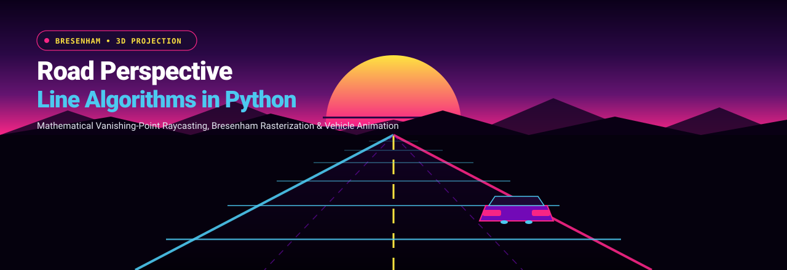

<p align="center">
  
</p>

<p align="center">
  <strong>3D Road Perspective Projection, Bresenham Line Generation, and Real-Time Vehicle Animation in Python</strong>
</p>

<p align="center">
  <a href="https://github.com/AbinVarghexe/Line-Algorithm/blob/main/LICENSE"></a>
  <a href="https://www.python.org/downloads/"></a>
  <a href="https://matplotlib.org/"></a>
  <a href="https://numpy.org/"></a>
  <a href="https://en.wikipedia.org/wiki/Bresenham%27s_line_algorithm"></a>
</p>

---

## Overview

**Line-Algorithm** is a mathematical computer graphics simulation in Python demonstrating 3D perspective projection and rasterization using fundamental computational geometry algorithms:
- **Bresenham's Integer Line Drawing Algorithm** for aliasing-free ray tracing between vanishing points and the view frustum.
- **Midpoint Circle Algorithm** for rendering synthetic celestial bodies (sun, moon, wheels).
- **Z-Buffer Scale Invariance & Vanishing Point Projections** mapping world coordinates $(X, Y, Z)$ into 2D camera viewport pixels $(x', y')$.
- **Matplotlib Animation Engine** orchestrating independent vehicles traveling along opposing lanes with realistic non-linear optical scaling.

```
       World Coordinates (X, Y, Z)
                   |
                   v
       Perspective Projection Matrix:
       x' = (X * d) / Z + x_center
       y' = (Y * d) / Z + y_center
                   |
                   v
       Bresenham Line Rasterization (dx, dy, D = 2dy - dx)
                   |
                   v
       Matplotlib FuncAnimation (60 FPS Double Buffer)
```

---

## Theoretical Formulations

### 1. Bresenham's Line Generation Algorithm
Bresenham's algorithm determines the points of an $n$-dimensional raster that should be selected in order to form a close approximation to a straight line between two points using only fast integer addition and bit shifts:

$$D_0 = 2\Delta y - \Delta x$$

For each step along $x$:
- If $D_k < 0$: $D_{k+1} = D_k + 2\Delta y$, coordinate $(x_{k+1}, y_k)$
- If $D_k \ge 0$: $D_{k+1} = D_k + 2\Delta y - 2\Delta x$, coordinate $(x_{k+1}, y_k + 1)$

### 2. Vanishing Point 3D-to-2D Projection
Road edges converge at an infinite horizon vanishing point $(V_x, V_y)$:

$$x(t) = V_x + (B_x - V_x) \cdot t$$

$$y(t) = V_y + (B_y - V_y) \cdot t^p$$

Where $t \in [0, 1]$ represents depth parameterization and $p > 1$ introduces non-linear vertical perspective compression.

---

## Features

- **Static & Dynamic Modes**: Choose between a high-resolution single-frame projection renderer (`road_perspective.py`) or an interactive animated simulation (`animated_road.py`).
- **Dynamic Multi-Vehicle Traffic**: Simulates oncoming and receding vehicles with proportional perspective scaling (objects shrink exponentially as they approach the horizon).
- **Procedural Scenery**: Generates roadside utility poles, segmented dashed highway lane markers, mountain silhouettes, and a retrowave horizon sun.
- **Cross-Platform Zero-Dependency**: Requires only standard `numpy` and `matplotlib`.

---

## Getting Started

### 1. Prerequisites

- Python 3.8 or later
- Virtual environment (recommended)

### 2. Installation

```bash
# Clone the repository
git clone https://github.com/AbinVarghexe/Line-Algorithm.git
cd Line-Algorithm

# Install dependencies
pip install numpy matplotlib
```

### 3. Execution

```bash
# Run the animated real-time simulation
python animated_road.py

# Alternatively, generate the static high-res graphic output
python road_perspective.py
```

---

## Repository Structure

```
Line-Algorithm/
├── assets/
│   └── banner.svg               # Vector visual banner
├── animated_road.py             # Real-time animated traffic simulation
├── road_perspective.py          # Static line rasterization & perspective generator
├── road_perspective.png         # Rendered image artifact
├── CODE_EXPLANATION.md          # In-depth algorithmic breakdown
├── start_animation.sh           # Shell launch shortcut
└── README.md                    # Documentation & mathematical formulas
```

## License

This project is licensed under the MIT License - see the [LICENSE](LICENSE) file for details.
